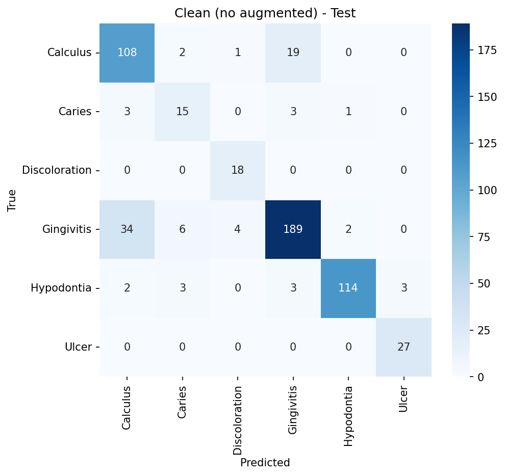

# Oral Disease Classification (ResNet50)

Image classification of 6 oral conditions using transfer learning in PyTorch.

**Dataset:** [Oral Diseases (Kaggle)](https://www.kaggle.com/datasets/salmansajid05/oral-diseases)
**Classes:** Calculus, Caries, Discoloration, Gingivitis, Hypodontia, Ulcer

## Method
- ResNet50 pretrained on ImageNet
- Two-stage training: (1) train the new classification head, (2) fine-tune the whole network
- Class weights to handle class imbalance
- Stratified 80/10/10 train/validation/test split
- Trained on Google Colab (T4 GPU)

## Results

| Setup | Test accuracy | Macro F1 |
|---|---|---|
| With augmented images | 92.2% | 0.914 |
| Original images only (no leakage) | 84.6% | 0.836 |

The first number is optimistic: augmented images come from the same original photos, so near-duplicates can land in both train and test (data leakage). The second run removes augmented images and is the more realistic estimate.

## Findings
- Hypodontia and Ulcer were classified most reliably (F1 > 0.94 in the clean run).
- The main error source is confusion between Calculus and Gingivitis.
- Caries is the weakest class (F1 = 0.63), with only 219 original images.

## Limitations
- Some folders may still contain unlabeled augmented or duplicate images, so the real performance may be lower.
- Small test sets for Caries, Discoloration and Ulcer make their scores unstable.
- The model must pick one of the 6 classes even for non-dental images, and high softmax confidence does not mean a correct prediction.
- Not validated by a dentist. **This is an educational project, not a diagnostic tool.**

## Next steps
- Collect more images from different sources
- Add Grad-CAM to check what the model looks at
- Have labels reviewed by a dental professional

## Run
Open `notebook.ipynb` in Google Colab with a T4 GPU and run the cells in order.

## Author
Ahmed Lotfy
